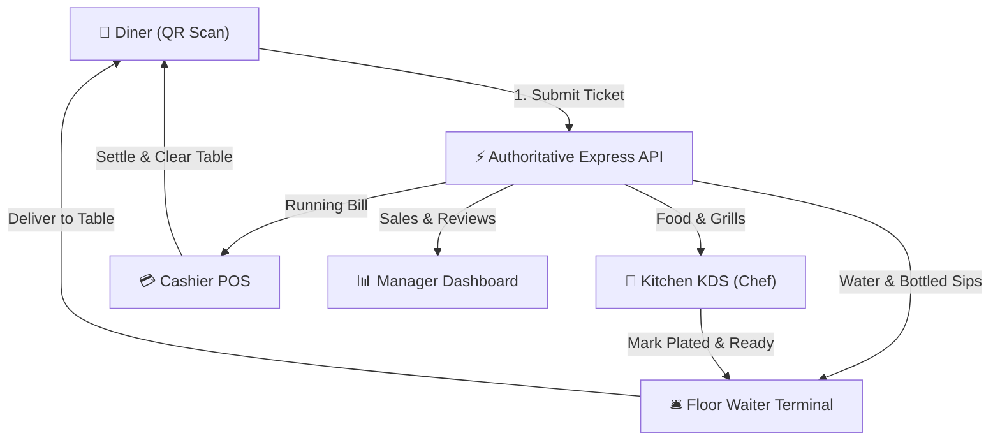

# The Break Room & QR-Based Restaurant Management OS 🍔🍹

> **Enterprise-grade, mobile-first QR table ordering and 5-role restaurant operating system built with React 18, TypeScript, Node.js Express, and authoritative financial calculation.**

[](https://github.com/officialthebreakroombogura)
[](https://nodejs.org/)
[](https://www.typescriptlang.org/)
[](https://vitejs.dev/)
[](https://tailwindcss.com/)

---

## 🌟 1. Project Architecture & Dual-Version Evolution

This repository powers two distinct editions of modern restaurant automation:

| Edition | Git Branch | Target Use Case & Highlights |
| :--- | :--- | :--- |
| **Version 1: Base Platform** | `main` | **Core 5-Role Modular Monolith Engine**: Generic domain-driven platform designed for multi-table dine-in establishments with KDS (Kitchen Display System), Waitstaff floor management, Cashier POS settlement, and Manager BI analytics. |
| **Version 2: Brand Customization** | `the-break-room` | **The Break Room Bogura Customization**: Tailored artisanal brand experience with real-world menu catalog, persistent floating bill point, direct water floor dispatch, live ordered dishes dining feedback, and signature punchline celebration. |

---

## 📌 2. Version 1 (`main`): The 5-Role Core Architecture

The foundational `main` branch establishes an end-to-end, zero-trust restaurant operating system featuring 5 synchronized consoles:



### Core Roles & Terminals:
1. **Diner QR Portal (`/` or `?table=T01`)**:
   - Zero-app-install browser QR experience.
   - Category filtering, dietary tags (*Chef's Special*, *Vegetarian*, *Spicy*, *Gluten-Free*), dish customization, calorie counts, and prep timers.
   - Authoritative server pricing preventing client-side price tampering.
   - Cumulative multi-round ordering (`Round 1`, `Round 2`, `Round 3`) onto an immutable running ticket.

2. **Kitchen Display System (KDS)**:
   - Live color-coded ticket grid for kitchen line cooks and head chefs.
   - One-click stage updates: `Start Cooking` ➔ `Mark Ready`.
   - Chronological timer badges highlighting tickets waiting the longest.

3. **Floor & Waitstaff Terminal**:
   - Interactive table layout visualizing seating capacity and live dining status (`Available`, `Dining`, `Food Ready`, `Bill Requested`).
   - Push notifications for plated dishes ready for server pickup (`🚀 GO Deliver`).

4. **Cashier POS Terminal**:
   - Digital and paper bill slip management.
   - Cash and card settlement engine with automatic table clearance for the next seating.

5. **Manager Analytics & Admin Console**:
   - Real-time revenue trackers, average ticket size, and hourly sales charts.
   - Dynamic menu inventory toggles (instant *In Stock* / *Sold Out* toggles and price updates).
   - Star rating distribution and customer feedback monitoring.

---

## 🔥 3. Version 2 (`the-break-room`): The Break Room Bogura Customization

The `the-break-room` branch contains the production-tuned customization created for **The Break Room Bogura** ([Facebook Page](https://www.facebook.com/officialthebreakroombogura)). It streamlines diner flow and waiter responsiveness with key innovations:

### 🎯 Key Enhancements in `the-break-room`:

#### 1. All-in-One Persistent Floating Bill Point
- Removed cumbersome multi-step cart subtotal bars and top navbar cart buttons.
- Pinned bottom-right floating circular bill badge (`Bill ৳0 • Table T01`) that stays persistently accessible.
- Clicking any dish's **"Add to Order"** immediately recalculates the running bill with a pulsing badge and live subtotal.
- Clicking the badge docks a responsive bottom sheet popup with `+`/`-` steppers, unit prices, VAT breakdown, and a single-click **"কনফার্ম অর্ডার (কিচেনে পাঠান)"** button.

#### 2. Smart Mineral Water Floor Routing (Bypasses Kitchen & Manager)
- Bottled water (Mum, Kinley 500ml) and cold beverages bypass kitchen cooking tickets entirely.
- Routes straight to the **Waitstaff Floor Terminal** under a dedicated *Direct Floor Service* alert.
- No manager approval required—water is immediately tallied into the customer's authoritative bill memo.
- Waiters click the redesigned **"সার্ভ সম্পন্ন করুন (Mark Served)"** action; the item is marked delivered and cleanly cleared from the waiter's queue without reappearing after refreshes.

#### 3. Simultaneous Food + Beverage Intelligence
- When diners order **both** cooked food and mineral water:
  - Water is dispatched rapidly by the floor waiter.
  - Serving water does **not** prematurely mark the food order as delivered.
  - The customer's voucher displays: `Water Dispatched — পানি টেবিলে দেওয়া হয়েছে (মূল খাবার কিচেনে প্রস্তুত হচ্ছে)` while the kitchen progress stepper continues running for the chef's items.
  - Dining feedback popups are strictly prevented from appearing until the cooked food is delivered.

#### 4. Post-Delivery Guest Feedback with Live Ordered Dishes
- The review section stays completely hidden during kitchen preparation.
- Triggers automatically as an elegant popup modal **only once food is served to table** (`status === 'Delivered'`).
- **Dynamic Dishes Selection**: Under *"What did you enjoy most? (Tap to select)"*, diners tap the exact dishes ordered in their live session (e.g., `Classic Smashed Cheeseburger ❤️`, `Crispy Peri-Peri Garlic Fries ❤️`), eliminating random or hardcoded items.
- **Professional Service & Ambiance Badges**: Includes visual chips for `⚡ Super Fast Service`, `😊 Friendly Staff`, `🛎️ Attentive Waiter`, `✨ Cozy & Warm Atmosphere`, and `🎵 Great Music & Vibe`.
- **Celebratory Thank-You Modal with Signature Punchline**:
  Upon submitting a review, a congratulatory modal appears:
  > *"Take a Break, Crave More! — দ্য ব্রেক রুমে আপনাকে আবারও স্বাগতম, আবার দেখা হচ্ছে!"*

#### 5. Session State Isolation & Clean Table Resets
- Session storage tracking ensures completed orders do not linger on the table upon browser refresh.
- Settle bill actions cleanly wipe the table session so subsequent diners receive a fresh `Bill ৳0` menu.

---

## 💻 4. Technology Stack & Monorepo Structure

```
resturent management/
├── backend/
│   ├── src/
│   │   ├── controllers/        # Order, Menu, Review, and Table controllers
│   │   ├── data/               # Seed data for The Break Room Bogura
│   │   ├── repositories/       # Repository Pattern interfaces & memory stores
│   │   ├── routes/             # RESTful endpoints (/api/orders, /api/tables, etc.)
│   │   ├── services/           # Authoritative business logic & tax calculations
│   │   ├── types/              # Domain interfaces & Order lifecycle types
│   │   └── server.ts           # Express server bootstrap (Port 5000)
│   └── package.json
├── frontend/
│   ├── src/
│   │   ├── components/
│   │   │   ├── ActiveOrderBanner.tsx     # Persistent floating bill widget & quick checkout
│   │   │   ├── OrderConfirmationView.tsx # Live order tracker, water dispatch, & feedback modal
│   │   │   ├── TableBanner.tsx           # Table greeting & dining room welcome
│   │   │   ├── Navbar.tsx                # Clean brand header with table switcher
│   │   │   └── staff/                    # Terminals: KDS, Waiter, Cashier, Manager
│   │   ├── services/api.ts               # Typed REST API service client
│   │   └── App.tsx                       # Single-page multi-portal orchestrator
│   └── package.json
└── README.md
```

---

## 🚀 5. Getting Started (Local Development)

### Prerequisites
- **Node.js**: v18.x, v20.x, or v22.x
- **Package Manager**: npm or yarn

### Quick Start

1. **Clone the Repository**:
   ```bash
   git clone https://github.com/officialthebreakroombogura/restaurant-management.git
   cd "resturent management"
   ```

2. **Switch to The Break Room Branch**:
   ```bash
   git checkout the-break-room
   ```

3. **Install Dependencies**:
   ```bash
   npm install --prefix backend
   npm install --prefix frontend
   ```

4. **Launch Development Servers**:
   ```bash
   # Terminal 1: Backend API (http://localhost:5000)
   npm run dev:backend

   # Terminal 2: Frontend Client (http://localhost:5173)
   npm run dev:frontend
   ```

5. **Open in Browser**:
   - Customer Table T01: [http://localhost:5173/?table=T01](http://localhost:5173/?table=T01)
   - Customer Table T02: [http://localhost:5173/?table=T02](http://localhost:5173/?table=T02)
   - Staff Switcher: Use the top portal navigation to switch between **Dine-In**, **Kitchen (KDS)**, **Waiter Floor**, **Cashier POS**, and **Manager Analytics**.

---

## 🌐 6. Deployment Guide

- **Frontend**: Hosted on [Vercel](https://vercel.com/) with single-page rewrite configuration (`vercel.json`).
- **Backend API**: Hosted on [Render](https://render.com/) or node container with environment variable:
  ```env
  VITE_API_BASE_URL=https://your-backend-api.onrender.com/api
  PORT=5000
  ```

---

## 📜 7. License & Credits

Developed with ❤️ for **The Break Room Bogura**. All rights reserved.  
*"Take a Break, Crave More! — Artisanal Smashed Burgers & Sips"*
